<!-- ==========================================================
              ROUNAK.OS  //  PLAYER PROFILE  //  v2026
========================================================== -->


<div align="center">


<br/>

<a href="https://github.com/rounak251"></a>
<a href="https://github.com/rounak251?tab=followers"></a>
<a href="https://github.com/rounak251/ml-freelance-portfolio"></a>

</div>

```text
   ██████╗  ██████╗ ██╗   ██╗███╗   ██╗ █████╗ ██╗  ██╗
   ██╔══██╗██╔═══██╗██║   ██║████╗  ██║██╔══██╗██║ ██╔╝
   ██████╔╝██║   ██║██║   ██║██╔██╗ ██║███████║█████╔╝
   ██╔══██╗██║   ██║██║   ██║██║╚██╗██║██╔══██║██╔═██╗
   ██║  ██║╚██████╔╝╚██████╔╝██║ ╚████║██║  ██║██║  ██╗
   ╚═╝  ╚═╝ ╚═════╝  ╚═════╝ ╚═╝  ╚═══╝╚═╝  ╚═╝╚═╝  ╚═╝
              >> PRESS START TO VALIDATE <<
```

---

# `> character_sheet`

<table>
<tr>
<td width="58%" valign="top">
<pre>
╔══════════════════════════════════════════════════════╗
║  NAME    : Rounak Choudhary                          ║
║  CLASS   : ML Engineer (models + the evals that      ║
║            test them)                                ║
║  LEVEL   : 3rd-year engineering student, grinding    ║
║  GUILD   : Kaggle · LeetCode · open source           ║
║  MOTTO   : Trust the split, not the score.           ║
╠══════════════════════════════════════════════════════╣
║  STATS  (pulled from LeetCode, not self-rated)       ║
║                                                      ║
║  SOLVED   217   C++ only                             ║
║  EASY     ████████░░░░░░░░░░░░  89                   ║
║  MEDIUM   ██████████░░░░░░░░░░  110                  ║
║  HARD     ██░░░░░░░░░░░░░░░░░░  18                   ║
║  CONTEST  1579 rating · top 27.7%                    ║
╠══════════════════════════════════════════════════════╣
║  EQUIPPED                                            ║
║                                                      ║
║  MAIN HAND : Python · PyTorch · scikit-learn         ║
║  OFF HAND  : C++ for DSA                             ║
║  ARMOR     : pytest · Docker · CI                    ║
║  RELIC     : group-aware cross-validation            ║
╚══════════════════════════════════════════════════════╝
</pre>
</td>
<td width="42%" valign="top">
<h3><code>&gt; quick_access</code></h3>
<pre>
CURRENT QUEST : KAGGLE CASMI 2026
FOCUS         : ML · EVALUATION · DSA
STATUS        : OPEN TO FREELANCE
MODE          : SPLIT → TRAIN → VALIDATE
                → SHIP
</pre>
<p align="center">
<a href="https://github.com/rounak251/ml-freelance-portfolio"></a>
<br/>
<a href="https://www.kaggle.com/rounakchoudharynitp"></a>
<a href="https://leetcode.com/u/eFEKtTD0Q3/"></a>
<br/>
<a href="https://github.com/rounak251/leetcode-solutions"></a>
</p>
</td>
</tr>
</table>

<sub>LeetCode numbers are from my public profile on 18 Oct 2026. Every project number below links to the repo that produced it.</sub>

---

# `> now_playing`

<div align="center">

| 🔨 ACTIVE QUEST | 📖 TRAINING | 🚢 LAST LOOT | 🎯 NEXT UNLOCK |
|:---:|:---:|:---:|:---:|
| [Kaggle CASMI 2026](https://www.kaggle.com/competitions/enveda-CASMI26-molecule-id-mass-spectra): MS/MS spectra → molecule ranking | LeetCode contests in C++ | [soil-grain-ml](https://github.com/rounak251/soil-grain-ml): nested CV on 24 samples | First Kaggle medal |

</div>

---

# `> skill_tree`

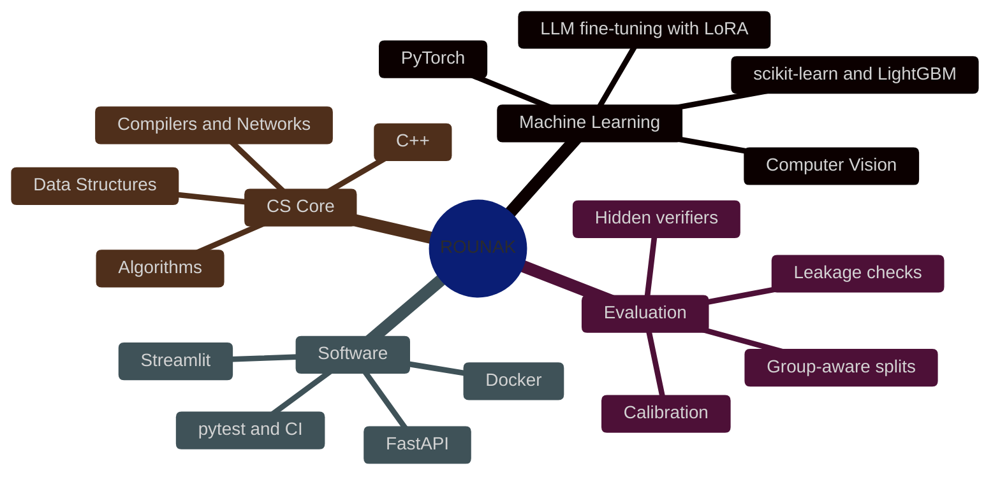

---

# `> the_validation_ladder`

Every score I report says which rung it reached. It's my one house rule.

```text
  🎲 RANDOM SPLIT  →  👥 GROUP SPLIT  →  🔒 HELD-OUT  →  🌍 REAL WORLD
   "it scored 0.99"   "no shared groups"   "touched once"   "new data agrees"
```

> Same model, same data, from the [ml-eval-guardrails](https://github.com/rounak251/ml-eval-guardrails) demo: random K-fold **1.000**, group K-fold **0.373**.
> The label was tied to the recording session. Only one of those numbers is real.

---

# `> quest_log`

## 📜 QUEST 01 · CHURN-RISK-SERVICE

[](https://github.com/rounak251/churn-risk-service)

```text
┌──────────────────────────────────────────────────────┐
│ MISSION BRIEFING                   LOOT: +36% PROFIT │
│ Goal : Tell a retention team who to call this        │
│        month, and prove the calls pay for            │
│        themselves                                    │
│ Test : 1,409 held-out customers, touched once        │
└──────────────────────────────────────────────────────┘
```

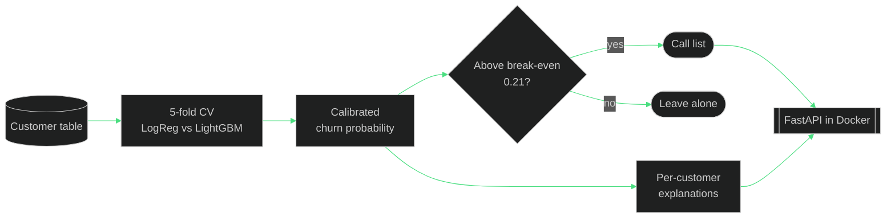

```text
BUILT      ✔  training, calibration, contact policy, API
TESTED     ✔  pytest + CI
MEASURED   ✔  held-out: $42.5k profit vs $31.3k at the 0.5 cut-off
LIMITS     ·  profit assumes a $50 offer, 30% save rate, $800 value
```

**⚔️ Weapons:** probability calibration · cost-based thresholds · FastAPI · Docker
**💀 Boss fight:** the default 0.5 cut-off. Once the probabilities are calibrated, a call pays off above 50 / (0.3 × 800) ≈ 0.21. Moving the threshold there is where the extra 36% came from.

---

## 📜 QUEST 02 · LABELOPS

[](https://github.com/rounak251/labelops)

```text
┌──────────────────────────────────────────────────────┐
│ MISSION BRIEFING             TYPE: HUMAN-IN-THE-LOOP │
│ Goal : Choose what to label next, settle reviewer    │
│        disagreements, measure what labels change     │
│ Proof: 51 tests · entropy vs random benchmark        │
└──────────────────────────────────────────────────────┘
```

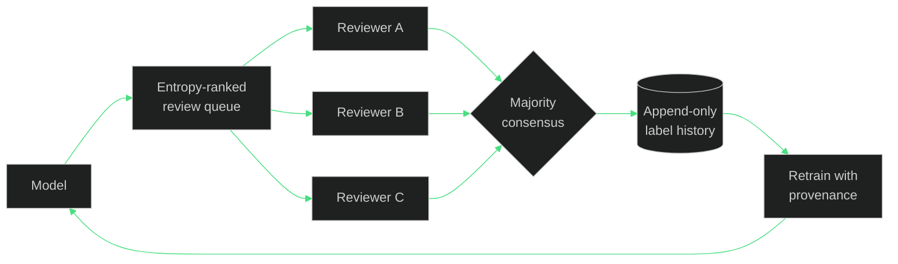

```text
BUILT      ✔  Streamlit UI, FastAPI service, CLI
TESTED     ✔  51 tests + CI
MEASURED   ✔  300 labels, 3 seeds: entropy 95.19% vs random 93.06%
LIMITS     ·  small digits dataset, simulated reviewers
```

**⚔️ Weapons:** active learning · consensus labelling · model provenance · FastAPI
**💀 Boss fight:** proving active learning helps at all. The only fair test is equal label budgets against random picks, so that's the benchmark, and it says nothing about real annotation savings.

---

## 📜 QUEST 03 · AGENT-EVAL-TASKS

[](https://github.com/rounak251/agent-eval-tasks)
[](https://github.com/rounak251/ml-eval-guardrails)

```text
┌──────────────────────────────────────────────────────┐
│ MISSION BRIEFING             CLASS: EVAL ENGINEERING │
│ Goal : Bug-fix tasks where a plausible-looking       │
│        fix still fails the hidden verifier           │
│ Gate : no-op fails · oracle passes 3x · no leaks     │
└──────────────────────────────────────────────────────┘
```

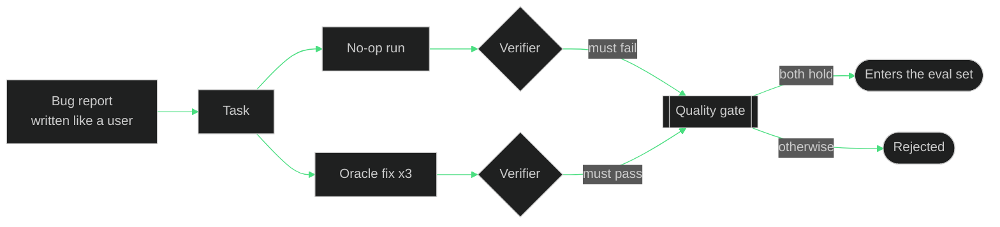

```text
BUILT      ✔  4 tasks, verifiers, oracle fixes, validator
TESTED     ✔  quality gate runs in CI on every task
MEASURED   ✔  every task: no-op fails, oracle passes 3 of 3
LIMITS     ·  4 tasks so far; each bug is small on purpose
```

**⚔️ Weapons:** hidden behavioural verifiers · oracle fixes · leakage checks · pytest
**💀 Boss fight:** tests that grep the source. They reward a fix that looks right, so the gate rejects any task whose tests read the code instead of running it.

---

## 📜 QUEST 04 · SOIL-GRAIN-ML

[](https://github.com/rounak251/soil-grain-ml)

```text
┌──────────────────────────────────────────────────────┐
│ MISSION BRIEFING                       ARENA: KAGGLE │
│ Goal : Predict a soil's grain-size curve from        │
│        photos, with only 24 labelled samples         │
│ Split: nested leave-one-soil-sample-out              │
└──────────────────────────────────────────────────────┘
```

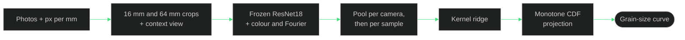

```text
BUILT      ✔  physical-scale crops, camera-balanced pooling, valid CDFs
TESTED     ✔  synthetic checks
MEASURED   ✔  nested CV EMD 44.1 vs 97.2 baseline · public LB 66.0
LIMITS     ·  24 labels; CV can't see the camera shift
```

**⚔️ Weapons:** physical calibration · nested validation · frozen CNN features · Kaggle T4 GPU
**💀 Boss fight:** the public leaderboard came in 21.9 EMD worse than nested CV. Train photos are from Motorola and Samsung phones, test photos from iPhones, and a sample-level split can't measure that shift. The cause isn't proven yet, and the README says so.

---

## 📜 QUEST 05 · AIR-DEFENSE-TRACKER

[](https://github.com/rounak251/Air-Defense-Tracker)

```text
┌──────────────────────────────────────────────────────┐
│ MISSION BRIEFING                  TYPE: REAL-TIME CV │
│ Goal : Spot drones and aircraft in live video        │
│        and plot them on a radar screen               │
│ Stack: YOLOv8 · OpenCV · PyQt5, multi-threaded       │
└──────────────────────────────────────────────────────┘
```

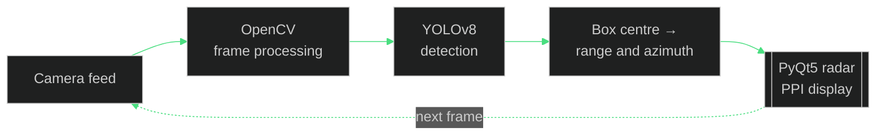

```text
BUILT      ✔  detection thread, coordinate conversion, radar GUI
TESTED     ✗  no test suite yet
MEASURED   ✗  no accuracy numbers yet
LIMITS     ·  range and azimuth come from box position, not a sensor
```

**⚔️ Weapons:** YOLOv8 · OpenCV · PyQt5 · threading
**💀 Boss fight:** keeping the radar sweep smooth while the detector runs. Inference lives on its own thread so the GUI never waits for a frame.

---

## 🗺️ SIDE QUESTS

<div align="center">

| Quest | Loot | Stack |
|:---|:---|:---|
| [ml-eval-guardrails](https://github.com/rounak251/ml-eval-guardrails) | Tested checks for leaky splits, train/test shift, lazy graders, non-determinism and metric-optimal decoding | Python · scikit-learn · pytest |
| [leetcode-solutions](https://github.com/rounak251/leetcode-solutions) | 217 accepted solutions by topic, synced by LeetHub | C++ |
| [movie-recommender-system](https://github.com/rounak251/movie-recommender-system) | 5 nearest movies from plot, cast, genres and director, with posters | Python · scikit-learn · Streamlit |
| [hotelweb](https://github.com/rounak251/hotelweb) · [live](https://rounak251.github.io/hotelweb/) | Hotel booking site with a Flask/SQLite booking API | HTML · CSS · JS · Flask |
| [python-mini-projects](https://github.com/rounak251/python-mini-projects) | Sudoku solver GUI, WebSocket and TCP chat, KNN car-evaluation classifier, games | Python |
| [college-labs](https://github.com/rounak251/college-labs) | AI search, automata and compilers, networks, algorithms | C · C++ · Python · Lex |

</div>

---

# `> achievements`

<div align="center">

| | Achievement | Unlocked by |
|:---:|:---|:---|
| 🧠 | **Two-Hundred Club** | 217 LeetCode problems in C++: 89 easy · 110 medium · 18 hard |
| ⚔️ | **Contest Regular** | LeetCode contest rating 1579, top 27.7% |
| 💰 | **Profit Hunter** | +36% profit over the default cut-off in churn-risk-service |
| 🧪 | **Verifier Smith** | 4 agent tasks where the no-op fails and the oracle passes 3 of 3 |
| 🛰️ | **Radar Operator** | YOLOv8 detections plotted live on a PPI display |
| 📏 | **Honest Scorer** | Published a leaderboard score that disagreed with my own CV, gap and all |
| 🔒 | **???** | First Kaggle medal. In progress. |

</div>

---

# `> patch_notes`

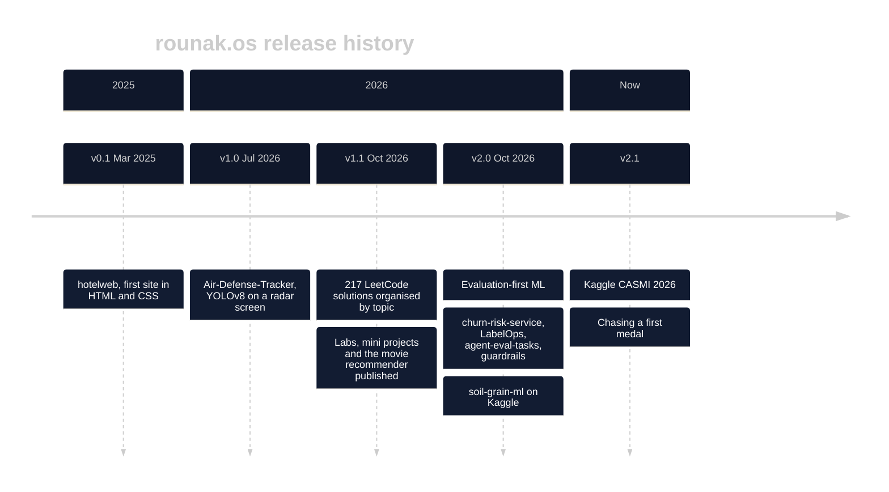

---

# `> inventory`

<div align="center">


</div>

---

# `> lore`

<details>
<summary><b>▶ How I build (the process)</b></summary>

<br/>

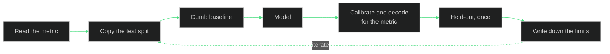

Four questions for every project: **What does the metric reward? Does my split look like the test? Did I beat a dumb baseline? What can't my validation see?**

</details>

<details>
<summary><b>▶ The five house rules</b></summary>

<br/>

1. **Ask which split before trusting a score.** Random K-fold can hide a model that's at chance.
2. **Beat a dumb baseline first.** Contact nobody, contact everyone, predict the median.
3. **Decode for the metric, not for 0.5.** Expected F1 and profit both pick different cut-offs.
4. **Same input, same bytes out.** If two runs differ, the score is noise.
5. **Results ship with their limits.** A number without its caveats is marketing.

</details>

<details>
<summary><b>▶ Current campaign roadmap</b></summary>

<br/>

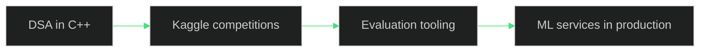

</details>

---

# `> telemetry`

<div align="center">


<a href="https://leetcode.com/u/eFEKtTD0Q3/"></a>

</div>

<details>
<summary><b>▶ Commit activity (last 30 days)</b></summary>

<div align="center">

<br/>

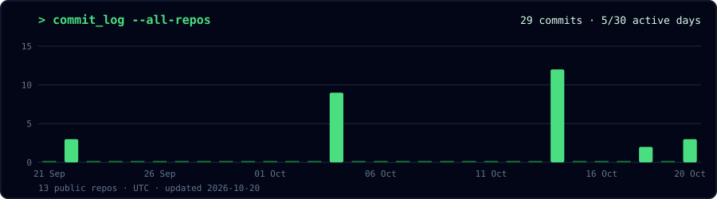

<a href="https://github.com/rounak251/leetcode-solutions">
  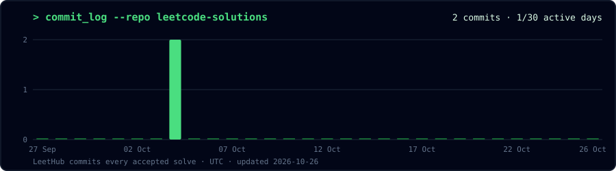
</a>

<sub>Redrawn every night by a GitHub Action · UTC</sub>

</div>

</details>

---

# `> secret_level`

```console
rounak@github:~$ ls -a ~/hidden
.one_more_submission   .chai_dependency   .seed_42

rounak@github:~$ python validate.py --split random
CV: 1.000  ✔  suspiciously good

rounak@github:~$ python validate.py --split group
CV: 0.373  ✔  the real number

rounak@github:~$ fortune
"If the validation can be gamed, the score means nothing."
```

---

# `> multiplayer`

<div align="center">

<a href="https://github.com/rounak251"></a>
<a href="https://www.kaggle.com/rounakchoudharynitp"></a>
<a href="https://leetcode.com/u/eFEKtTD0Q3/"></a>
<a href="https://github.com/rounak251/ml-freelance-portfolio"></a>

<br/><br/>

### `< Split. Train. Validate. Ship. />`
**SAVE POINT REACHED. CONTINUE? [ Y ]**


</div>
